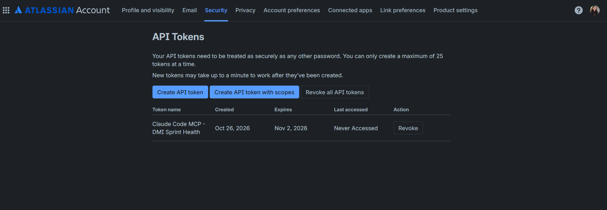
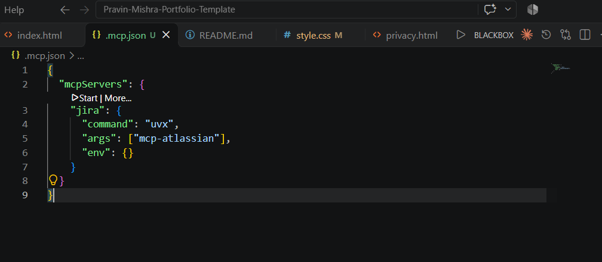
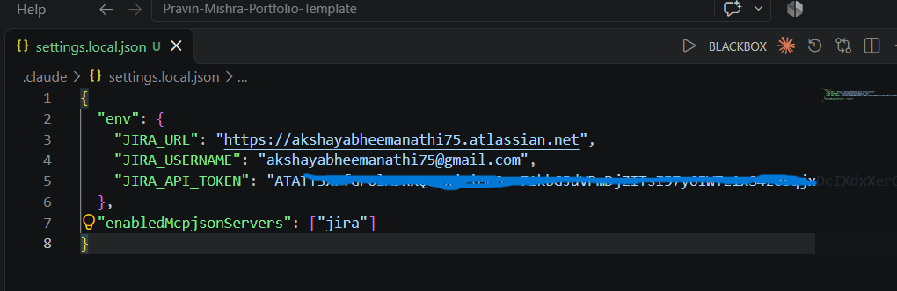
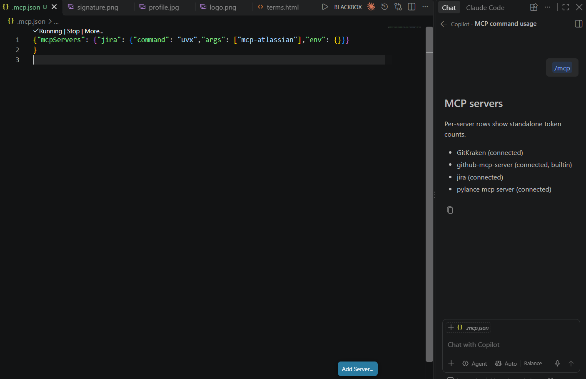
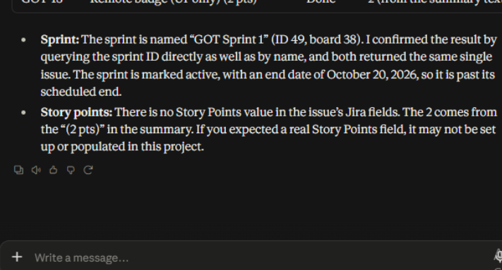
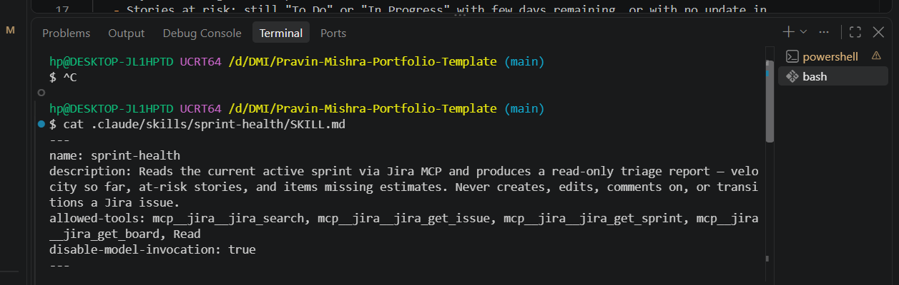
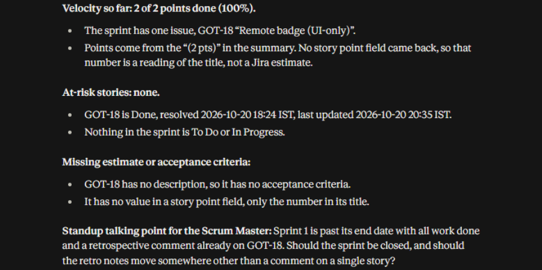
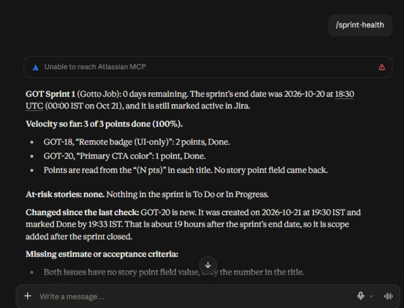

# Assignment 5 — AI-Assisted Sprint Health Report via Jira MCP

Part of the DevOps Micro Internship (DMI) with Agentic AI

---

## Purpose

In this assignment, you will connect Claude Code to your Jira board through an MCP server, the same way you connected it to GitHub in Week 2, and build a read-only `/sprint-health` skill. The skill reads your current sprint through Jira's API and reports sprint velocity, stories at risk of missing the sprint, and items missing an estimate — but it must never create, edit, comment on, or transition a single ticket itself. You will prove that boundary holds by making a real change on the board yourself and confirming the skill only ever reports, never acts.

---

# Task 1 — Create a Jira API Token

## Goal

Generate an API token from your Atlassian account that the MCP server will use to authenticate with your Jira site. Do not screenshot the token value itself.

### Evidence

#### Screenshot 1 — Jira API token creation confirmation page showing the token name, with the token value not visible

### Notes You Must Write (Very Important):

Why does the MCP server need your site URL and account email in addition to the token?

The MCP server needs all three details for authentication:
- Site URL tells it which Jira workspace to connect to, such as your-company.atlassian.net.
- Account email identifies which Atlassian user account is making the request.
- API token works like a secure password that proves the request is authorized.
So, the email + token verify your identity, while the site URL tells the server where to access Jira data.

---

# Task 2 — Create .mcp.json at the Project Root

## Goal

Create or update `.mcp.json` at your project root with a Jira MCP server block, following the same shape as the GitHub MCP server you configured in Week 2.

### Evidence

#### Screenshot 2 — `.mcp.json` open in VS Code showing the Jira server configuration

### Notes You Must Write (Very Important):

Compare this jira block to the github block from Week 2 Assignment 5. The GitHub server ran via npx (a Node.js package); this one runs via uvx (a Python package) — what stays exactly the same shape despite that difference, and why doesn't Claude Code care which language a given MCP server is written in?

The Jira and GitHub MCP configurations use the same overall structure inside `mcpServers`. Each server has a server name, a `command` used to start it, an `args` list for package or startup arguments, and an `env` object for environment variables or credentials. The only difference is the runtime: GitHub uses `npx` because it is a Node.js package, while Jira uses `uvx` because it is a Python package.

Claude Code does not care whether an MCP server is written in Node.js, Python, or another language. It starts the server using the configured command and communicates with it through the standard Model Context Protocol. As long as the server follows MCP rules and exposes tools in the expected format, Claude Code can use it the same way regardless of the programming language behind it.

---

# Task 3 — Add Your Credentials to settings.local.json

## Goal

Add your Jira site URL, account email, and API token to `.claude/settings.local.json`, and confirm that file is listed in `.gitignore` so it is never committed.

### Evidence

#### Screenshot 3 — `settings.local.json` open in VS Code showing the `env` section, with the actual token value blurred or covered

### Notes You Must Write (Very Important):

Why must JIRA_API_TOKEN live in settings.local.json and never in .mcp.json?

JIRA_API_TOKEN must be stored in `settings.local.json` because it is a private credential that gives access to my Jira account. This file is local to my computer and should be included in `.gitignore`, so it is not committed to Git or uploaded to GitHub.

The `.mcp.json` file should contain only the shared Jira MCP server configuration, such as the command used to start the server. It may be shared with other project members and committed to the repository, so it must never include API tokens, passwords, or other secrets.

---

# Task 4 — Verify the Connection with /mcp

## Goal

Restart Claude Code and confirm the Jira MCP server shows as connected.

### Evidence

#### Screenshot 4 — `/mcp` output showing `jira: connected`

---

# Task 5 — Run a Live Query to Prove Real Board Data

## Goal

Ask Claude to list the issues in your current active sprint through the Jira MCP connection, and confirm the result matches what you see on your live board in the browser.

### Evidence

#### Screenshot 5 — Claude's response showing the live sprint issue list retrieved via Jira MCP

### Notes You Must Write (Very Important):

How did you confirm this was real board data and not something Claude guessed?

I confirmed the result was real board data because Claude Code used the connected Jira MCP server and displayed information returned from Jira, including issue keys, summaries, statuses, assignees, priorities, and sprint details. I then opened the Jira board in my browser and compared the returned issue list and ticket statuses with the live board.

The information matched the Jira board, so it was retrieved from the connected Jira project rather than guessed or fabricated by Claude.

---

# Task 6 — Build the /sprint-health Skill

## Goal

Create a `/sprint-health` skill restricted to read-only Jira tools plus `Read`, with no issue-mutating tools and no `Write`. Run it and confirm it produces a report covering sprint velocity, at-risk stories, and items missing an estimate.

### Evidence

#### Screenshot 6 — `SKILL.md` frontmatter showing `allowed-tools` limited to read-only Jira tools plus `Read`, with `disable-model-invocation: true`

#### Screenshot 7 — `/sprint-health` output showing the full triage report against your real sprint

### Notes You Must Write (Very Important):

1. Which Jira MCP tools does this skill's allowed-tools list include, and which mutating tools (create issue, update issue, transition issue, add comment) does it deliberately exclude?

The skill’s allowed-tools list includes only read-only Jira MCP tools: mcp__jira__jira_search, mcp__jira__jira_get_issue, mcp__jira__jira_get_sprint, and mcp__jira__jira_get_board, along with the local Read tool. It deliberately excludes all mutating Jira tools, including tools to create an issue, update an issue, transition an issue to another status, or add a comment. It also excludes Write.

2. Why does a Scrum Master need this restriction more than almost any other role in this course?

A Scrum Master needs this restriction because the role supports the team’s process and uses board data to identify risks, blockers, and progress. The Scrum Master should not allow an AI tool to silently change priorities, estimates, statuses, assignments, or comments, because those changes affect team accountability and sprint reporting. The skill can provide evidence and talking points, but the human Scrum Master must decide and make every board change manually.

---

# Task 7 — Prove the Skill Never Mutates the Board

## Goal

Manually update one ticket on your board in the browser (for example, move a story to "Done" or add a missing estimate), then run `/sprint-health` again and confirm the new report reflects your change — proving the skill only ever reads live state and never wrote to the board itself.

### Evidence

#### Screenshot 8 — Second `/sprint-health` run showing the report now reflects your manual board change

### Notes You Must Write (Very Important):

Map this assignment to Gather → Analyze → Human Act → Verify from Week 3 Assignment 6. Which step did you perform manually in the browser, and why must that step stay human?

This assignment follows the Gather → Analyze → Human Act → Verify workflow:

- **Gather:** The Jira MCP reads live sprint and issue data from the Jira board.
- **Analyze:** The `/sprint-health` skill reviews that data and reports velocity, risks, missing estimates, and possible standup talking points.
- **Human Act:** I manually updated a Jira ticket in the browser, such as changing its status or adding an estimate.
- **Verify:** I ran `/sprint-health` again and confirmed that the new report reflected the change I made.

The Human Act step must stay human because changing a Jira issue can affect sprint metrics, workflow status, ownership, and the team’s commitments. The AI should report evidence and help the Scrum Master decide what to discuss, but a person must review the situation and intentionally make any board change.

---

# Submission Instructions

Complete all tasks in sequence.

Your submission must include:
- All 8 required screenshots
- All the required notes

---

# Completion Checklist

- [✅] Task 1: Jira API token created, value never screenshotted (Screenshot 1)
- [✅] Task 2: `.mcp.json` has the Jira server block (Screenshot 2)
- [✅] Task 3: Credentials stored in `settings.local.json`, token blurred, file gitignored (Screenshot 3)
- [✅] Task 4: `/mcp` shows the Jira server connected (Screenshot 4)
- [✅] Task 5: Live query returned real sprint data, verified against the browser (Screenshot 5)
- [✅] Task 6: `/sprint-health` skill created with correct read-only `allowed-tools`, and produced a full report (Screenshots 6–7)
- [✅] Task 7: A manual board change was reflected in a second `/sprint-health` run (Screenshot 8)
- [✅] Skill never created, edited, transitioned, or commented on any issue
- [✅] Reflection answered (Notes)
- [✅] No API token value exposed

---

## 📌 About DMI & CloudAdvisory

DevOps Micro Internship (DMI) is a project-based DevOps program run by Pravin Mishra (The CloudAdvisory) focused on real-world execution, systems thinking, and career readiness.

It helps learners build strong DevOps foundations with hands-on experience.

---

## 📌 Resources

- 🌐 DMI Official Website: https://dmi.pravinmishra.com?utm_source=github&utm_medium=readme  
- 🎓 University: https://university.pravinmishra.com?utm_source=github&utm_medium=readme  
- 💬 Discord Community: https://discord.pravinmishra.com?utm_source=github&utm_medium=readme  
- 📝 Blog: https://dmi.pravinmishra.com/blog?utm_source=github&utm_medium=readme  
- ▶️ YouTube Playlist: https://www.youtube.com/playlist?list=PLFeSNDtI4Cho  
- 🔗 Pravin Mishra (LinkedIn): https://www.linkedin.com/in/pravin-mishra-aws-trainer/  
- 🏢 CloudAdvisory (LinkedIn): https://www.linkedin.com/company/thecloudadvisory/

---

*This submission is part of DevOps Micro Internship (DMI) — Agentic AI Track.*
